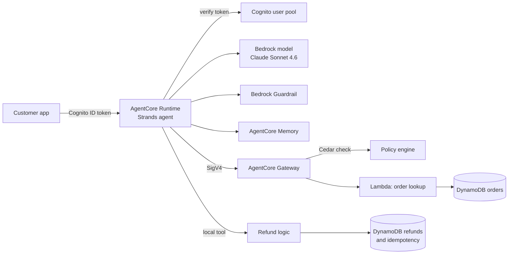
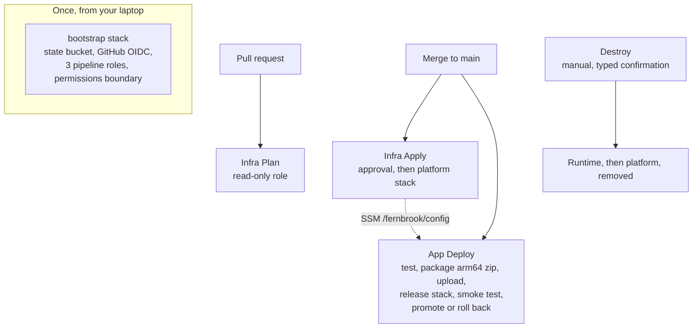

# Fernbrook Ops Agent

A production-style AI agent on **Amazon Bedrock AgentCore**, deployed entirely with **Terraform** and **GitHub Actions** (no stored AWS keys), and fully destroyable and redeployable.

The agent is a customer-support assistant for **Fernbrook Outdoor Supply**, a fictional retailer. All data is synthetic. The point of the project is not the chatbot. It is everything around it that makes an agent safe to run: identity, authorization outside the model, scoped IAM, memory, guardrails, observability, tests, a deployment pipeline with automatic rollback, and a clean teardown.

> **New here?** Start with [`docs/GETTING-STARTED.md`](docs/GETTING-STARTED.md). It walks you through deploying to your own AWS account step by step, with a check after every phase and a teardown at the end.
> **Preparing for an interview?** Read [`docs/INTERVIEW-GUIDE.md`](docs/INTERVIEW-GUIDE.md).

## What it does

A customer asks about an order. The agent:

1. Verifies the customer's Cognito token **in code**. The model never decides who the user is.
2. Calls a tool through **AgentCore Gateway** to look the order up (a Lambda reading DynamoDB).
3. Lets **Cedar policy** at the Gateway and an **ownership check in code** decide whether the customer may see that order. Asking for someone else's order returns nothing.
4. Remembers the conversation with **AgentCore Memory**.
5. Passes model traffic through a **Bedrock Guardrail**.
6. Emits traces and metrics you can inspect in CloudWatch.

## Architecture



Models decide what might be useful. Application policy decides what is allowed.

## How it is deployed

Three Terraform stacks, two pipelines, three narrowly scoped AWS roles:



| Stack | Run by | Contains |
|---|---|---|
| `infrastructure/bootstrap` | You, once, locally | Remote state bucket, GitHub OIDC provider, the three pipeline roles, the permissions boundary, optional budget alert |
| `infrastructure/platform` | Infra Apply workflow | DynamoDB, Lambda, Cognito, Guardrail, Memory, Gateway, Cedar policy, execution role, code bucket |
| `infrastructure/release` | App Deploy workflow | The AgentCore Runtime, pinned to one immutable code artifact |

The platform stack publishes its IDs to SSM Parameter Store (`/fernbrook/config/*`). The release stack and the app pipeline read them from there, so the app pipeline never needs platform permissions.

## Design decisions worth knowing

- **No long-lived AWS keys anywhere.** GitHub Actions authenticates with OIDC; each role trusts only this repository and a specific environment.
- **Pipelines cannot make themselves more powerful.** The infra role may create only three named workload roles, only with a permissions boundary attached, and is explicitly denied from editing the pipeline roles or the boundary.
- **Secrets stay out of Terraform state.** Terraform creates an empty Secrets Manager secret. A script generates the demo password and writes it straight to Secrets Manager.
- **Authorization lives outside the model.** Token verification, ownership checks and Cedar policy run in code and at the Gateway.
- **Deploy is gated on behavior, not just unit tests.** A post-deploy smoke test checks that a bad token is rejected, a customer can read their own order, and another customer's order does not leak. If it fails, the pipeline redeploys the previous good version.
- **Everything is destroyable.** One workflow tears down the runtime and platform. A local command removes the bootstrap. See [`docs/TEARDOWN.md`](docs/TEARDOWN.md).

## Current scope

**Deployed by the pipelines (milestone 1):** order lookup through Gateway and Lambda, Memory, Guardrail, Cognito identity, Cedar policy, refunds (a local tool backed by DynamoDB with an idempotency table), observability hooks.

**Not deployed yet (milestone 2):** the wholesale account lookup (an OpenAPI Gateway target with an API-key credential provider) and the Knowledge Base. Their code is in the repository. The agent degrades gracefully and says the tool is unavailable. `ops-monitor-agent/` is a second, staff-only agent that runs locally and is not deployed.

**Known limits:**
- `us-east-1` only. The Python code hardcodes the region and Terraform enforces it.
- One environment per AWS account, because resource names are fixed.
- The Terraform was written from provider documentation and debugged on its first end-to-end deployment (November 2026). [`docs/GETTING-STARTED.md`](docs/GETTING-STARTED.md#what-broke-on-the-first-deploy) lists the seven things that broke and how each was fixed.

## Repository layout

| Path | Purpose |
|---|---|
| `agent/` | The agent: Strands agent, Runtime entry point, refund logic, metrics helper |
| `identity/` | Cognito token verification and a test-token helper |
| `tools/` | Order lookup Lambda and synthetic data seeding; wholesale lookup (milestone 2) |
| `policy/` | The Cedar policy enforced at the Gateway |
| `memory/`, `knowledge/`, `observability/` | Notes and helper scripts for those capabilities |
| `infrastructure/bootstrap`, `platform`, `release` | The three Terraform stacks |
| `infrastructure/iam/` | Legacy policy documents from the manual setup path (kept for reference) |
| `evaluations/` | Evaluation dataset (15 scenarios), runner, regression comparison, cost template |
| `tests/` | Unit tests for refunds, token verification, Cedar policy structure, tool naming |
| `scripts/` | Packaging, demo-user setup, smoke test, chat client, GitHub setup |
| `.github/workflows/` | CI, infra plan, infra apply, app deploy, destroy |
| `docs/` | Getting started, teardown, interview guide, design notes, operations, troubleshooting |

## Cost

Everything here is pay-per-use and idle cost is low, but it is not zero while deployed, and model calls cost money. Set the optional budget alert in the bootstrap stack, deploy, try it, and destroy when you are done. Check current AWS pricing before relying on any estimate. `evaluations/estimate_cost.py` is a template with placeholder rates on purpose.

## Run the tests locally

```bash
python -m venv .venv
source .venv/bin/activate        # Windows PowerShell: .venv\Scripts\Activate.ps1
pip install -r requirements.txt
python -m pytest tests -q
```
